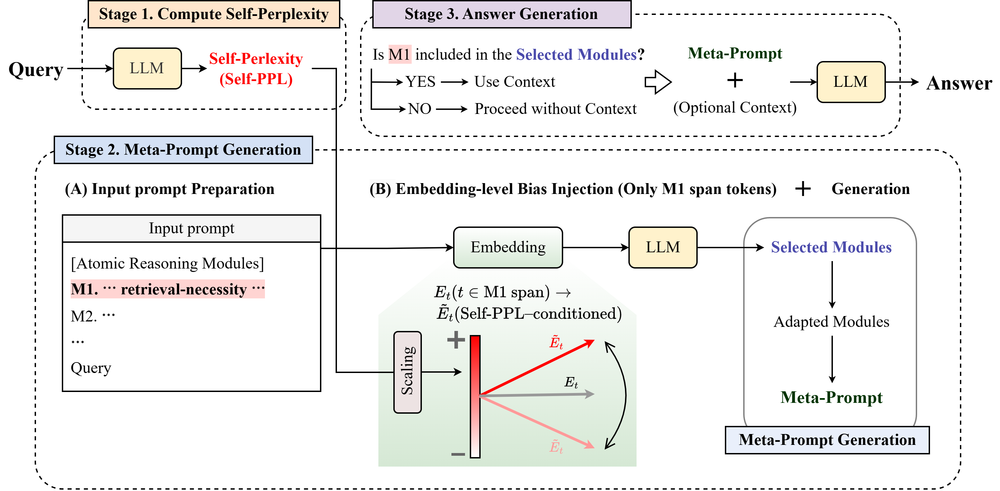

# [2026 EMNLP Findings] CWM: Controllable White-Box Meta-Prompting for Adaptive Retrieval-Augmented Generation and Reasoning Ability [](https://aclanthology.org/2026.findings-emnlp.56/)
> #### Keuntae Kim*, Eunhye Jeong*, Yong Suk Choi† 
> \*: Equal contribution, †: Corresponding author

<details>
  <summary><h2>Abstract</h2></summary>
  <div markdown="1">
    Recently, Large Language Models (LLMs) have gained significant attention due to their strong language understanding and generation capabilities, demonstrating impressive reasoning abilities as well as effective utilization of external knowledge. Many studies have proposed methods that specialize in improving performance for individual tasks. However, ironically, only a limited number of attempts have explored general-purpose, task-agnostic methods. In this work, we present a unified framework integrating reasoning and Retrieval-Augmented Generation (RAG) tasks. We further propose Controllable White-Box Meta-Prompting (CWM), a low-cost white-box method for adaptive RAG tasks previously dominated by black-box approaches, without requiring external decision modules or multi-sampling. CWM achieves state-of-the-art performance on three adaptive RAG benchmarks across recent LLMs, including GPT-oss-20b, Qwen3-14b, and Llama3.1-8b, while also demonstrating strong generality by extending to reasoning tasks. In addition, CWM provides controllability by enabling retrieval decisions to be regulated through the manipulation of internal model signals. Our code is available at https://github.com/JeongEunhye00/CWM.
  </div>
</details>

## Overview



## 💻 Running CWM
Run CWM using the following command:
```bash
python src/run_main.py \
    --model_name "generation_model_name" \
    --dataset_name "dataset_name" \
    --delta_gain_coef 0.07 \
    --alpha_neg_cap 1.0
```
### Experimental Settings
We used the following configurations in our experiments:
| Parameter | Values |
|-----------|--------|
| `model_name` | `gpt-oss-20b`, `qwen3-14b`, `llama-8b` |
| `dataset_name` | `BBH`, `T4D`, `MATH500`, `HotpotQA`, `StrategyQA`, `MuSiQue` |
| `alpha_neg_cap` | `0.0`, `1.0`, `1.5` |
| `delta_gain_coef` | `0.03`, `0.05`, `0.07`, `0.09` |


## 📚 Citation
```
@inproceedings{kim-etal-2026-cwm,
    title = "{CWM}: Controllable White-Box Meta-Prompting for Adaptive Retrieval-Augmented Generation and Reasoning Ability",
    author = "Kim, Keuntae  and  Jeong, Eunhye  and  Choi, Yong Suk",
    booktitle = "Findings of the {A}ssociation for {C}omputational {L}inguistics: {EMNLP} 2026",
    month = oct,
    year = "2026",
    address = "Budapest, Hungary",
    publisher = "Association for Computational Linguistics",
    url = "https://aclanthology.org/2026.findings-emnlp.56/",
    pages = "1144--1168",
    ISBN = "979-8-89176-462-0",
}
```
